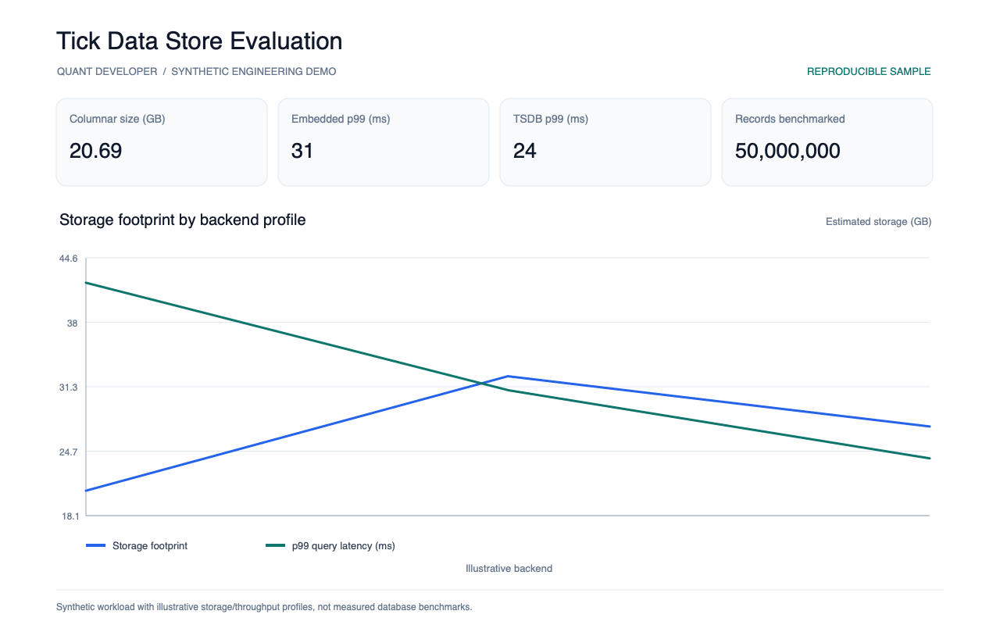
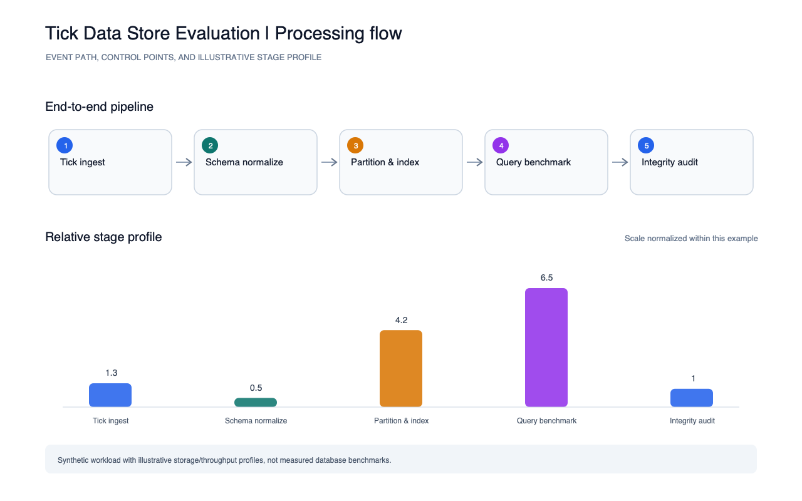

# Tick Data Store Evaluation

A reproducible comparison template for storage footprint, write/read throughput, query tail latency, index-build time, and integrity across three illustrative backend profiles.

Run `python3 run.py` to write `reports/metrics.json`.

Run the smoke test with `python3 -m unittest discover -s tests -v`. The report images were generated from these metrics by the portfolio's shared screenshot script.

The backend profiles are explicitly illustrative, not measured database results. Replace them with controlled tests on representative hardware and data before making a storage decision.
